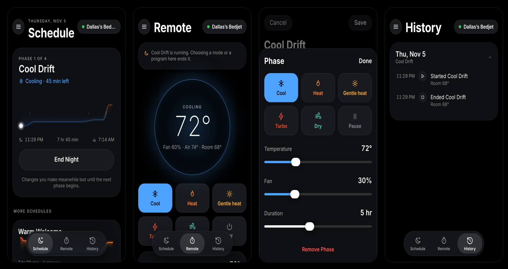
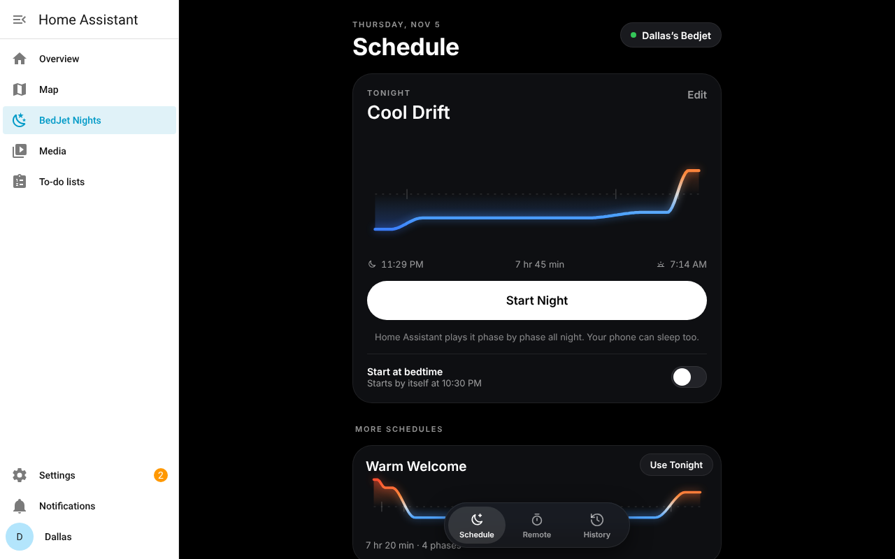

# BedJet Nights

Lull-style schedules, a remote and night history for your BedJet, built into Home Assistant.



## Why this exists

A BedJet accepts only one Bluetooth connection at a time. When Home Assistant holds it (through the
BedJet integration), a phone app such as [Lull](https://github.com/rkanjani/lull) or the official
BedJet app can't connect, and the other way round.

BedJet Nights brings Lull's best parts (schedules built from phases, the night curve, the remote
and the history) into Home Assistant itself. Home Assistant keeps the one Bluetooth connection, and
every phone, tablet and computer that can open Home Assistant gets the same BedJet Nights panel,
at home or away, in the browser or in the Home Assistant app.

## How it works

- Home Assistant talks to the BedJet over Bluetooth, as it does today, with the BedJet integration
  ([ha-bedjet](https://github.com/natekspencer/ha-bedjet) from HACS, or the built-in one).
- BedJet Nights is a second integration that works through the BedJet's entities. It adds a
  **BedJet Nights** panel to the sidebar, plays schedules through the night, keeps the history,
  and adds the night's controls to your BedJet's own device page.
- There is nothing extra to run: no container, no token, no MQTT.



## Features

- **Schedules.** Build a night from phases (Cool, Heat, Gentle heat, Turbo, Dry, Pause), each with its
  own temperature, fan speed and duration, and see the whole night as one curve. Starts with Lull's
  four starter schedules (Cool Drift, Warm Welcome, Hot Sleeper, Winter Cocoon).
- **The BedJet's own limits.** Temperatures stay inside what each mode allows, Turbo stops at 10
  minutes, and Heat follows the BedJet's safety table (hotter and faster air is cut off sooner).
- **Start Night**, or **Start at bedtime** on the nights you pick. Home Assistant plays the schedule
  phase by phase. Each phase also sets the BedJet's own shut-off timer to the end of that phase plus
  two minutes, so if Home Assistant stopped mid-night the BedJet would still turn itself off instead
  of running on.
- **Remote.** Mode, temperature, fan, the shut-off timer, and the programs saved on your BedJet
  (M1 to M3 and biorhythms). LED and beeps are in the BedJet sheet (tap the BedJet's name).
- **History.** Every change through the night, wherever it was made (the panel, a dashboard, an
  automation, the BedJet's remote), with the time and the room temperature. Nights run noon to noon,
  so 3 AM belongs with the evening before, and each night is redrawn as a curve.
- **Several BedJets.** Every BedJet in Home Assistant shows up. Tap the name at the top to switch.
- **Lend to a phone.** Pauses the BedJet integration for 15 minutes to 2 hours so the BedJet app or
  Lull can connect (for a firmware update, say), then takes the BedJet back by itself. Only
  administrators see this.
- **Entities for automations**, on each BedJet's device page:

  | Entity | What it does |
  | --- | --- |
  | `select.<bedjet>_tonight_s_schedule` | Tonight's schedule |
  | `button.<bedjet>_start_night` | Starts tonight's schedule |
  | `button.<bedjet>_end_night` | Ends the night and turns the BedJet off |
  | `switch.<bedjet>_start_at_bedtime` | Starts tonight's schedule by itself at its bedtime |
  | `binary_sensor.<bedjet>_night_running` | On while a schedule is running |
  | `sensor.<bedjet>_night` | For example "Cool Drift: Cooling, 45 min left (phase 1 of 4)" |
  | `sensor.<bedjet>_night_ends` | When the night's schedule ends |

  `<bedjet>` follows your BedJet's name in Home Assistant: for a BedJet named "Dallas’s Bedjet" the
  start button is `button.dallass_bedjet_start_night`. To start the night from an automation or a
  script, use this action:

  ```yaml
  action: button.press
  target:
    entity_id: button.dallass_bedjet_start_night
  ```

### How it differs from Lull

Lull writes tonight's schedule into the BedJet's memory and lets the BedJet run it, because a phone
can leave the room. Home Assistant's BedJet integration has no way to write programs, and Home
Assistant never leaves, so BedJet Nights plays the schedule from Home Assistant instead. In practice:

- Changes made during a night (in the panel, elsewhere in Home Assistant, or on the BedJet's remote)
  last until the next phase begins, as in Lull.
- Turning the BedJet off ends the night. Choosing a mode or a saved program in the Remote tab ends it
  too, as in Lull. The BedJet's own timer running out does not: the next phase picks up.
- If Home Assistant restarts mid-night, the night carries on from where it should be.

## Install

You need Home Assistant 2026.2 or later with the BedJet integration working, and
[HACS](https://hacs.xyz).

1. In Home Assistant, open **HACS**, then the menu in the top corner, then **Custom repositories**.
2. Add `https://github.com/dallasjanssen/bedjet_ha` with the type **Integration**.
3. Find **BedJet Nights** in HACS, select **Download**, then restart Home Assistant.
4. Go to **Settings**, **Devices & services**, **Add integration**, and choose **BedJet Nights**.
   There is nothing to fill in.
5. **BedJet Nights** appears in the sidebar. Your BedJets are found by themselves.

To update, HACS shows a new version when one is published. Your schedules and history are kept in
Home Assistant's own storage and survive updates and restarts.

## Troubleshooting

- **"Can't reach your BedJet"**: Home Assistant isn't connected to it. Make sure the BedJet app and
  Lull are closed on every phone, and that the BedJet integration shows the BedJet as available.
- **No BedJet in the panel**: BedJet Nights looks for climate entities from the `bedjet`
  integration. Check that your BedJet appears under **Settings**, **Devices & services**, **BedJet**.
- **The panel looks out of date after an update**: refresh the page (in the Home Assistant app,
  pull down to refresh) so the browser loads the new version.

## Development

The tests run against Home Assistant itself, with a simulated BedJet (`dev/fake_bedjet`) that behaves
like the ha-bedjet integration:

```bash
pip install -r requirements-dev.txt
python -m pytest
```

To click around without hardware, `dev/run-ha.sh` starts Home Assistant with BedJet Nights and the
simulated BedJet (it needs `pip install homeassistant home-assistant-frontend` first).

| Path | What it is |
| --- | --- |
| `custom_components/bedjet_nights/model.py` | Phases, schedules, the BedJet's limits, and nights rebuilt from history |
| `custom_components/bedjet_nights/bedjet.py` | One BedJet as Home Assistant shows it: reading its state and calling its actions |
| `custom_components/bedjet_nights/nights.py` | Plays schedules, bedtime starts, history, lending |
| `custom_components/bedjet_nights/websocket.py` | The commands the panel uses |
| `custom_components/bedjet_nights/panel.py` | Adds the sidebar panel |
| `custom_components/bedjet_nights/frontend/` | The panel (plain JavaScript and CSS, no build step) |
| `custom_components/bedjet_nights/{select,button,switch,binary_sensor,sensor}.py` | The entities on each BedJet's device page |

## Credits

The phase model, the BedJet's limits and heat table, the starter schedules, the night curve and the
history view follow [Lull](https://github.com/rkanjani/lull) by Rohan Kanjani (MIT). See
[NOTICE](NOTICE). Home Assistant's side of the BedJet is [ha-bedjet](https://github.com/natekspencer/ha-bedjet)
by natekspencer.

BedJet Nights is an independent project, not affiliated with or endorsed by BedJet LLC or Lull.
